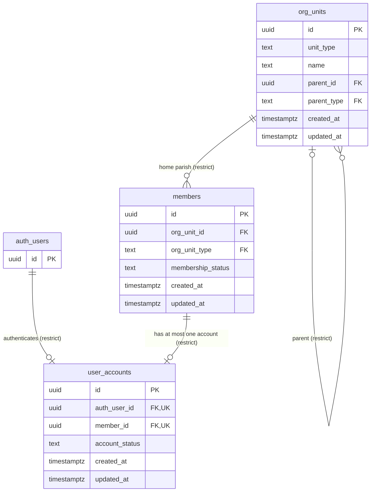

# ERD: Identity Foundation (Sprint 1B.1)

This diagram describes the schema created by `supabase/migrations/20261008090000_identity_foundation.sql`.
It is verified against the real database catalog by `tests/database/erd.test.ts` (columns, types, PK/FK/UK flags and relationship cardinality), so it cannot silently drift from the implementation. `auth_users` is Supabase Auth's `auth.users` table, owned by Supabase; only its `id` is shown.

## Reading the diagram
- **Person → Member → Account:** a `members` row is the person's CYON member record. It may exist without an account (a pending applicant). A `user_accounts` row always has exactly one member and exactly one auth identity (`UK` on both foreign keys).
- **Separate lifecycles:** `members.membership_status` (pending, active, inactive, suspended, archived) and `user_accounts.account_status` (pending_activation, active, suspended, deactivated) are independent columns. Executive assignments and permissions are deliberately absent; they arrive in a later sprint as separate tables.
- **Organisation:** `org_units` is a typed adjacency tree (archdiocese, deanery, parish). `parent_type` and `org_unit_type` exist so the database can verify, with plain composite foreign keys, that a parent has the expected type and that a member's home unit is a parish. Unspecified composite uniqueness `(id, unit_type)` on `org_units` supports those keys and is not drawn.
- **Not drawn:** CHECK constraints, triggers (immutability, no physical delete), indexes and RLS. See `DATABASE_IDENTITY.md` and `DATABASE_SECURITY.md`.
